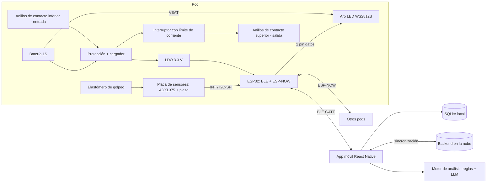

# Pod inteligente de entrenamiento para boxeo y artes marciales
**Propuesta técnica para un prototipo funcional de 8 semanas (≤ $1,500 MXN)**

> **Cómo leer este documento.** Cada dato lleva una etiqueta: **[Confirmado]** (verificado en una fuente consultada), **[Estimado]** (cálculo o rango razonable, sin verificar), **[Hipótesis]** (supuesto de diseño a validar) y **[Verificar]** (dato que debes comprobar antes de comprar o fabricar).
> **No pude verificar precios, existencias ni enlaces de tiendas mexicanas.** Los precios en MXN son rangos estimados y la sección G indica cómo comprobarlos. El único precio confirmado es el del módulo ADXL375 de Adafruit (USD 24.95, adafruit.com/product/5374). No incluyo enlaces de compra inventados.

> **Actualización posterior.** Las decisiones de este documento fueron revisadas en *Revisión crítica de arquitectura, escalabilidad y viabilidad*, cuya sección **"Decisiones vigentes"** prevalece. Cambios ya aplicados aquí: app en **React Native** (no Flutter), **gateway BLE + ESP-NOW** como arquitectura de comunicación, **pogo magnéticos con contactos rehundidos** para el apilamiento, LDO **AP2112K** (no AMS1117), celda con pestañas y el presupuesto con los **precios cotizados por el equipo** (sección G.1b).

---

## 0. Contradicciones detectadas en los requerimientos (resumen)

| # | Contradicción | Consecuencia | Resolución propuesta |
|---|---|---|---|
| C1 | "Medir la fuerza" de un golpe con sensores de bajo costo. | La fuerza de un golpe (cientos a miles de N, 1–20 ms) no se mide directamente con FSR ni con celdas HX711. | Se entrega un **índice de fuerza de impacto calibrado** (N equivalentes) estimado a partir de aceleración e impulso. No se presenta como fuerza medida directamente. |
| C2 | Aceleración = fuerza. | Solo F = m·a si se conoce la masa efectiva y el pod está libre. Un pod apoyado en piso o pared transmite el impacto al soporte. | Calibración por condición de montaje (piso, pared, apilado). Se reporta aceleración (g) como medición directa y fuerza como estimación. |
| C3 | "Carga inalámbrica" por apilamiento. | Con contactos metálicos es **carga por contacto eléctrico**, no inalámbrica. La inducción (Qi) es posible pero no encadena módulos y es menos eficiente. | Contactos concéntricos (anillos + pogo pins). Se documenta como "carga por contacto". |
| C4 | La cara superior es superficie de golpeo y también interfaz de apilamiento con contactos energizados. | Contactos expuestos a sudor, golpes y cortos. | Zona de golpeo central de elastómero; anillos de contacto **rebajados** en una corona perimetral; salida superior **desenergizada** hasta detectar un pod encima. |
| C5 | Presupuesto de $1,500 MXN **total**, pero se requieren "varios módulos". | Un pod instrumentado ya consume ~$1,000–1,400 [Estimado] con el sensor de alta g. | Se asume que $1,500 cubre **1 pod instrumentado completo**. Los módulos adicionales (versión reducida) se tratan como costo aparte. **Confírmalo con tu asesor.** |
| C6 | Precisión > 90 % "de la IA". | Un único porcentaje mezcla magnitudes distintas. | Métricas separadas por función (sección I). |
| C7 | HarmonyOS. | Las herramientas varían según la versión del sistema (ver sección F). | Se declara como objetivo deseable, no indispensable. |
| C8 | Primera versión funcional en semana 3 con carga por apilamiento, multi-pod e IA. | No cabe todo. | La semana 3 demuestra **1 pod**: LEDs, impacto, tiempo de reacción, BLE y app básica. Apilamiento y multi-pod llegan después. |

---

## A. Síntesis del proyecto

**Funcionamiento.** Cada pod enciende un patrón en su aro de LEDs. El usuario lo golpea. El pod toma una marca de tiempo (µs) al encender el LED y otra al detectar el impacto en un pin de interrupción. La diferencia es el **tiempo de reacción**, medido **localmente** en el pod, por lo que la latencia inalámbrica no entra en la medición. En el impacto se captura una ventana corta de aceleración (±200 g) y de un canal piezoeléctrico, y de ahí se calculan pico de aceleración, impulso y un índice de fuerza. Un pod actúa como *gateway* BLE hacia el teléfono y se coordina con los demás por ESP-NOW.

**Subsistemas.** (1) Sensado de impacto. (2) Iluminación. (3) Procesamiento y comunicación. (4) Energía y carga. (5) Mecánica. (6) App y datos. (7) Análisis con IA.

**Retos principales.**
1. Medir impactos violentos con un sensor que no se dañe ni sature.
2. Separar el contacto real de las vibraciones por apilamiento o caídas.
3. Distribuir 3 h de autonomía con 12–16 LEDs.
4. Contactos de carga robustos y seguros en la cara que se golpea.
5. Entregar todo en 8 semanas con hardware importado.

---

## B. Matriz de requerimientos

Prioridad: **I** = indispensable, **M** = importante, **D** = deseable.

| ID | Requerimiento | Subsistema | Pri. | Verificación | Criterio de aceptación | Riesgo |
|---|---|---|---|---|---|---|
| RF-01 | Aro de LEDs con patrones configurables | Iluminación | I | Inspección + prueba funcional | ≥ 5 patrones; visible a 3 m con luz de gimnasio | Bajo |
| RF-02 | Detectar impacto y marcar tiempo | Sensado | I | Comparación con analizador lógico | Sesgo < 2 ms y σ < 2 ms [Hipótesis] | Medio |
| RF-03 | Tiempo de reacción LED→impacto | Firmware | I | Banco con pulsador y referencia | ≥ 90 % de mediciones dentro de ±5 ms de la referencia | Medio |
| RF-04 | Medir aceleración del impacto | Sensado | I | Banco de caída/péndulo | Error ≤ ±10 % vs. referencia en el rango calibrado [Hipótesis] | Medio |
| RF-05 | Índice de fuerza de impacto | Sensado + calibración | M | Péndulo con energía conocida | Repetibilidad CV < 10 %; error ≤ ±20 % en prototipo [Hipótesis] | **Alto** |
| RF-06 | Sensores protegidos dentro de la carcasa | Mecánica | I | Inspección tras ensayo de impactos | Sin daño en 10,000 impactos | Medio |
| RF-07 | Wi-Fi y Bluetooth | Comunicación | I | Prueba de enlace | Conexión estable con teléfono Android e iOS | Bajo |
| RF-08 | Sincronización multi-pod | Comunicación | M | Prueba de latencia/pérdida | Pérdida de comandos < 1 %; latencia < 20 ms entre 2 pods | Medio |
| RF-09 | Datos a la app | Software | I | Prueba extremo a extremo | 100 % de impactos de una sesión de 100 eventos recibidos | Bajo |
| RF-10 | Autonomía ≥ 3 h | Energía | I | Descarga con perfil de uso | ≥ 3 h con brillo y duty definidos | Medio |
| RF-11 | Protección de batería | Energía | I | Pruebas eléctricas | Corte por sobrecarga, sobredescarga y cortocircuito | Alto (seguridad) |
| RF-12 | Carga por apilamiento | Carga | M | Prueba de carga con 2–3 pods | Corriente de carga estable; temperatura de contacto < 45 °C | Alto |
| RF-13 | Solo el pod inferior se conecta a la fuente | Carga | M | Prueba funcional | Pods superiores cargan sin cable | Alto |
| RF-14 | App: sesiones, gráficas, historial | App | I | Pruebas funcionales | Sesión guardada y comparable con anteriores | Bajo |
| RF-15 | App: rutinas | App | I | Pruebas funcionales | Crear, guardar y ejecutar una rutina | Medio |
| RF-16 | App: análisis con IA | App/IA | M | Evaluación con rúbrica | Ver sección I | Medio |
| RF-17 | Perfil, rutinas, desempeño, leaderboard, recompensas, IA | App | M | Revisión de pantallas | 6 secciones navegables; leaderboard local en v1 | Medio |
| RF-18 | Uso con una sola mano | UX | M | Prueba con 5 usuarios | Acciones principales alcanzables con el pulgar | Bajo |
| RF-19 | iOS ≥ 14, Android ≥ 8 | App | I | Dispositivos reales | Funciona en ≥ 1 dispositivo por plataforma | Medio |
| RF-20 | HarmonyOS | App | D | Prueba en dispositivo | Ver sección F | Alto |
| RNF-01 | Dimensiones ≤ 15×15×15 cm | Mecánica | I | Medición | Ø ≤ 140 mm × alto ≤ 80 mm | Bajo |
| RNF-02 | BOM ≤ $1,500 MXN | Presupuesto | I | Facturas | Suma ≤ $1,500 (ver supuesto C5) | **Alto** |
| RNF-03 | PCB ≤ 2 capas, pitch ≥ 0.8 mm | PCB | I | DRC y revisión | Cumple | Bajo |
| RNF-04 | Entrega < 3 semanas | Compras | I | Confirmación de pedidos | Todos los pedidos con ETA < 3 semanas | Medio |
| RNF-05 | Banda 2.4 GHz con módulos con documentación | Regulatorio | I | Revisión documental | Módulo con certificaciones documentadas | Bajo |
| RNF-06 | Mantenimiento y acceso | Mecánica | M | Prueba de desarmado | Cambio de batería y PCB en < 5 min con herramienta básica | Bajo |

---

## C. Arquitectura del sistema

### C.1 Diagrama de bloques

### C.2 Arquitectura electrónica
- Un MCU por pod (ESP32). El tiempo de reacción se calcula en el pod.
- **Placa de sensores pequeña, rígida y fijada a la placa interior de golpeo**, con acelerómetro y piezo. **Placa principal** (MCU, energía) montada sobre soportes de silicona para aislarla del choque.
- Sensor de impacto en dos canales: acelerómetro ±200 g (medición y detección) y disco piezoeléctrico con limitador (detección de toques ligeros y respaldo del inicio del evento).

### C.3 Arquitectura mecánica
- Cuerpo cilíndrico (Ø ≈ 130 mm × ≈ 70 mm). Dentro del límite de 15 cm.
- De arriba hacia abajo: tapa de elastómero de golpeo → placa rígida interior con sensores → difusor de luz con aro LED → batería → placa principal → base con pogo pins.
- Corona perimetral rebajada con anillos de contacto en la cara superior, y pogo pins en la cara inferior.

### C.4 Arquitectura de software
Firmware (ESP-IDF o Arduino-ESP32) → GATT BLE → app React Native → SQLite → sincronización → motor de análisis (sección F).

---

## D. Selección de componentes (comparativa por subsistema)

> Precios en MXN: **[Estimado]**, sin verificar en tiendas. Cambio supuesto 18.5 MXN/USD **[Verificar]**.

### D.1 Microcontrolador
| Opción | Ventajas | Desventajas | Costo | Consumo | Veredicto |
|---|---|---|---|---|---|
| **ESP32-WROOM-32E (módulo, DevKit para prototipo)** | Dual core, BLE + Wi-Fi + ESP-NOW, ecosistema enorme, pads 1.27 mm | Consumo con radio activo; ADC poco lineal | $90–180 | ~100 mA con radio en RX [Estimado] | **Elegido** |
| ESP32-C3 (DevKit / MINI-1) | Más barato, BLE 5, menor consumo | Un solo núcleo; **verificar pitch del módulo MINI-1 (≥ 0.8 mm)** | $80–150 | Menor | Alternativa |
| nRF52840 | BLE excelente y bajo consumo | Sin Wi-Fi/ESP-NOW; más difícil de conseguir barato | $250+ | Muy bajo | Descartado |

### D.2 Sensores de fuerza e impacto
| Tecnología | Medición | Velocidad | Resistencia a impactos | Integración | Costo | Veredicto |
|---|---|---|---|---|---|---|
| **Piezo (disco 27 mm)** | Señal proporcional a la variación de fuerza; no estática; poco calibrable en absoluto | µs | Alta si va detrás del elastómero | Simple (limitador + comparador/ADC) | $5–20 | **Complemento** (detección y tiempo de inicio) |
| Celda de carga + HX711 | Fuerza **directa** y estática | 10/80 SPS (≈ 12.5 ms por muestra) | Media (se sobrecarga) | Simple, pero **demasiado lenta** para picos de 5–20 ms | $100–200 | Solo como **referencia de calibración estática** |
| FSR (tipo 402) | Fuerza aproximada | ~ms | Media | Simple | $150–300 | **Descartado**: rango del orden de decenas de N, se satura |
| Galga extensométrica + amplificador de instrumentación | Directa y de buena precisión | kHz con ADC adecuado | Media | Compleja (puente, amplificación, ADC rápido) | $200+ | Futura versión |
| **Acelerómetro ±200 g** | Aceleración **directa**; fuerza estimada con calibración | ~1 ms | Alta (ADXL375: 10,000 g) | Simple (I2C/SPI) | ver D.3 | **Elegido** |

#### D.2b Ruta opcional de fuerza directa: galga extensométrica o celda de carga

**Qué implica.**
- **Puente de Wheatstone completo** (4 galgas o una celda de carga comercial), alimentado a 3.3 V. Con una sensibilidad típica de ~1–2 mV/V la salida a escala completa es de unos 3–7 mV **[Estimado]**.
- **Amplificador de instrumentación** (p. ej. INA125, INA333 o similar) con ganancia de ~100–500 **[Verificar]** disponibilidad, encapsulado y pitch ≥ 0.8 mm; si no, usar módulo.
- **ADC rápido.** El HX711 entrega 10 o 80 SPS: no sirve para un pico de 5–20 ms. Alternativas: ADS1115 (hasta 860 SPS, ≈ 1.2 ms por muestra, suficiente para describir un pulso de 10–20 ms con pocos puntos) o un ADC mayor como ADS1256 en módulo (30 kSPS **[Verificar]**). El ADC interno del ESP32 es poco lineal y ruidoso.
- **Elemento elástico (flexión) y topes mecánicos.** Un golpe puede superar con facilidad el rango de una celda de 50–100 kg (≈ 500–1,000 N): sin topes, se sobrecarga y se pierde el cero. Hay que rigidizar para que la frecuencia propia del conjunto quede muy por encima del ancho de banda del impacto, a costa de menor señal.
- **Proceso de pegado de galgas** (limpieza, adhesivo, curado) y compensación térmica. Es el paso más delicado y el que más tiempo de aprendizaje consume.
- **Calibración** con masas conocidas (estática) y con péndulo/caída (dinámica).

**Cómo incorporarla.** Entre la placa rígida de golpeo y la base del pod, **en la ruta de carga**: placa → celda (o 3–4 apoyos con galgas) → base. Así mide la fuerza transmitida al soporte **sin depender de si el pod está en el piso, la pared o apilado**, que es justo la debilidad del índice basado solo en aceleración (contradicción C2). Hay que considerar que una pila superior añade precarga estática y que los pogo pins deben quedar fuera de la ruta de carga.

**Veredicto.** Mejora el requisito de fuerza, pero cuesta ≈ $150–400 por pod **[Estimado]**, añade complejidad mecánica y de calibración y compite con las 8 semanas. **No entra en el prototipo base.** Entra como **fase de mejora (semanas 5–6) si el ADXL375 llega a tiempo y sobra presupuesto**, o en una versión futura.

**¿Celda de carga + HX711 junto al acelerómetro y el piezo?**
- **No reemplaza al acelerómetro:** la aceleración se pide como medición directa, y el HX711 no captura el impacto.
- **No reemplaza al piezo:** el piezo da el inicio del evento en microsegundos y detecta toques ligeros; el HX711 tiene retardo de decenas de ms.
- **Sí es útil como instrumento de referencia en el banco de calibración** (una sola vez, no en cada pod): valida la ganancia en carga estática y sirve para tarar. Para la dinámica, el impulso se valida por conservación de la cantidad de movimiento (masa conocida, velocidad antes y después del choque).
- **Dentro de cada pod** aportaría, como mucho, la detección de precarga o de pod apilado y mediciones de presión sostenida. Con el HX711 solo, eso no justifica el costo ni el espacio. Con un ADC rápido, pasa a ser la ruta de fuerza directa descrita arriba.

### D.3 Acelerómetro
| Opción | Datos clave | Costo | Veredicto |
|---|---|---|---|
| **ADXL375 (módulo)** | ±200 g, ancho de banda hasta 1 kHz, 2.0–3.6 V, 10,000 g de supervivencia, detección de golpes en hardware, FIFO de 32 niveles **[Confirmado: analog.com/ADXL375]**. Módulo Adafruit: USD 24.95 **[Confirmado]** | ≈ $460 + envío/importación [Estimado] | **Elegido**, pero es el componente más caro y de importación |
| H3LIS331DL (módulo) | ±100/200/400 g; **verificar** disponibilidad local y ODR | $150–300 [Estimado, verificar] | **Alternativa económica** si el ADXL375 rompe el presupuesto o el plazo |
| ADXL345 / MPU6050 / LIS3DH | ±16 g | $40–80 | **Descartados**: se saturan. Un golpe de ~500 N sobre un pod de ~0.4 kg implica ~130 g [Estimado: a = F/m] |

El IC desnudo ADXL375 tiene precio de lista desde USD 5.80 a 1 ku **[Confirmado]**, pero es un LGA-14 de 3×5 mm. Requiere reflujo y verificar el pitch del encapsulado en el datasheet; **no es viable con el equipo de laboratorio sin confirmar**. Se usa el módulo.

### D.4 Aro de LEDs
| Opción | Ventajas | Desventajas | Costo |
|---|---|---|---|
| **Aro WS2812B/SK6812 de 12–16 LEDs (módulo)** | Un solo pin de datos, programable, disponible localmente | 60 mA/LED a blanco total; temporización estricta | $60–130 [Estimado] |
| LEDs discretos con registros (74HC595/TLC) | Control de corriente, RGB limitado | Más PCB y componentes | $80–150 |

Se limita el brillo por firmware (≈ 40 %) por consumo y para evitar deslumbrar. Datos a 3.3 V con alimentación del LED desde la batería (3.3–4.2 V) suele funcionar; **[Verificar] en banco** (umbral de entrada ≈ 0.7·VDD).

### D.5 Batería y gestión
| Opción | Ventajas | Desventajas | Costo |
|---|---|---|---|
| **Celda 18650 protegida 1S (≥ 2,000 mAh) con pestañas y cables** | Rígida, robusta ante golpes; evita el resorte del portacelda, que puede perder contacto con los impactos | Volumen; riesgo de celdas falsas; capacidad real por medir | $100–200 [Estimado]; cotizado ≈ $125 |
| LiPo de bolsa 1S 2,000 mAh con PCM | Plana y ligera | Vulnerable a presión y perforación | $100–180 |

- **Cargador:** módulo TP4056 con USB-C y protección (1 A, SOP-8 de 1.27 mm) para el prototipo; para la PCB propia, MCP73831 (500 mA, SOT-23-5) **[Verificar]** disponibilidad y pitch.
- **Regulador:** LDO de 3.3 V con baja caída (p. ej. AP2112K-3.3, ~600 mA) **[Verificar]** hoja de datos.
- **Protección:** celda con PCM integrada + fusible reseteable + TVS en los contactos.

### D.6 Carga por apilamiento
| Opción | Eficiencia | Seguridad | Fabricación | Alineación | Desgaste | Costo | Veredicto |
|---|---|---|---|---|---|---|---|
| **Pogo pins + anillos concéntricos de cobre (PCB)** | Alta (~90 %+ [Estimado]) | Media: contactos expuestos → salida conmutada | Fácil | **Independiente de la rotación** | Bajo-medio (dorado/ENIG) | $30–60 | **Elegido** |
| Pads planos + imanes | Alta | Media | Fácil | Requiere orientación | Medio | $30–50 | Alternativa |
| Inductiva Qi | Menor (~50–70 % [Estimado]) | Alta (sin contactos) | Bobinas; **no encadena** pods | Sensible a distancia | Nulo | $100+ | Descartado |

Diseño eléctrico por pod: anillos inferiores (entrada) → fusible → TVS → [cargador de su batería] + [interruptor con límite de corriente → anillos superiores]. El interruptor se habilita solo si se detecta un pod encima. Para el prototipo se limita la pila a 3 pods y ≤ 500 mA por pod (≈ 1.5 A en el contacto inferior), con **dos pogo pins en paralelo por anillo** **[Verificar]** la corriente nominal del modelo elegido.

**Variante elegida por el equipo: pogo magnéticos con contactos rehundidos.** Los contactos quedan por debajo del pad de golpeo para que el pad reciba el impacto antes que el aro del pogo. Ajustes de diseño:
- **Tolerancias:** la almohadilla se comprime varios milímetros bajo un golpe, probablemente más que el desnivel. Se añade un labio perimetral más alto que el aro de contacto y se calcula la apilación de tolerancias (desnivel + compresión vs. recorrido del pogo, ≈ 1–2 mm **[Pendiente: según el modelo]**).
- **Carga estructural:** un hombro mecánico soporta el peso del apilado; los contactos no cargan estructura.
- **Energía en contactos:** un sensor Hall detecta el imán del pod de arriba y habilita la salida con límite de corriente **[Hipótesis: validar en banco]**.
- **Alimentación:** el MCU se alimenta de la batería, no del contacto, para que el rebote no lo reinicie.
- **Corriente:** carga por pod ≈ 500 mA (ajustar la resistencia de programación del TP4056, que viene en 1 A); verificar la capacidad nominal del conector, que muchos anuncios no especifican.
- **Modo carga:** al detectar apilamiento se apagan los estímulos y se duerme el acelerómetro, para evitar falsos positivos en los pods inferiores.
- **Costo:** un par comercial (≈ $150 cotizado) es macho + hembra, lo que necesita un pod simétrico. Con un par se prueba un pod sobre una base de maqueta; apilar 2 pods exige un segundo par. Para un lote, pines sueltos + imanes (≈ $30 por pod, estimado del equipo).
- **Hito:** prototipo en las semanas 4–5; continuar o descartar al cierre de la semana 5.

### D.7 Comunicación
| Opción | Latencia | Consumo | Nº de dispositivos | Compat. móvil | Veredicto |
|---|---|---|---|---|---|
| **BLE (pod↔teléfono)** | Intervalo de conexión ≥ 15 ms en iOS [Verificar guía de Apple] | Bajo | iOS/Android admiten varias conexiones simultáneas, con límites [Verificar] | Universal | **Enlace con la app** |
| **ESP-NOW (pod↔pod)** | Del orden de pocos ms [Estimado; Verificar en banco] | Medio (radio en RX) | Hasta ~20 pares [Verificar documentación de Espressif] | No hay soporte en teléfonos | **Elegido entre pods** |
| Wi-Fi (AP/STA + UDP/MQTT) | Variable | Alto | Muchos | Requiere cambiar de red en el teléfono | Opcional (OTA, sincronización masiva) |
| BLE Mesh | Alta latencia | Bajo | Muchos | Complejo | Descartado |

**Arquitectura elegida:** un pod hace de **gateway BLE** hacia el teléfono y los demás se comunican con él por **ESP-NOW**. Se evita que el teléfono mantenga N conexiones BLE simultáneas, que es el punto débil en iOS y no se puede corregir. El rol de gateway es intercambiable (cualquier pod puede asumirlo; la app elige el de mayor batería), con confirmación de eventos en la aplicación y reenvío por `seq`. La coexistencia BLE + ESP-NOW en el ESP32 es posible, pero **[Verificar] en banco** (semana 4) el efecto en latencia, pérdida de paquetes y consumo del gateway. **Plan B:** BLE entre pods (3–4 seguidores) o ventanas alternadas de BLE y ESP-NOW.

**Por qué BLE y no Wi-Fi para la app:**
- **El tiempo de reacción no depende del enlace.** Se mide dentro del pod; el teléfono solo recibe resultados. La ventaja de latencia del Wi-Fi no aporta a la medición.
- **El volumen de datos cabe en BLE.** Un evento (RT, pico, impulso, duración) ocupa decenas de bytes, y una ventana de forma de onda de ~50 muestras × 3 ejes × 2 bytes ≈ 300 B **[Estimado]**.
- **Consumo.** Mantener el radio Wi-Fi activo cuesta más corriente que una conexión BLE **[Verificar en banco con el perfil real]**, y el consumo pesa en el requisito de 3 h.
- **Experiencia en el teléfono.** Con Wi-Fi directo, el teléfono debe unirse a la red del pod y suele perder internet (sincronización en la nube, llamadas a la API de IA). iOS y Android piden además permisos y avisos de red local **[Verificar]**. BLE no cambia la red del teléfono y tiene plugins maduros en Flutter.
- **Conexión y reconexión.** El emparejamiento BLE es más directo en la app.
- **Cuándo sí usar Wi-Fi:** actualización OTA de firmware, descarga de ondas crudas para calibración y sincronización masiva. Si el gimnasio ofrece Wi-Fi con aislamiento de clientes, el pod no sería alcanzable por esa red **[Verificar]**. Por eso queda como canal opcional, no principal.

### D.8 PCB
| Opción | Ventajas | Desventajas |
|---|---|---|
| **PCB propia de 2 capas, hecha en el laboratorio** | Integra todo, cumple el requisito | Depende del equipo: **[Verificar]** ancho mínimo de pista, vías (¿metalizadas?), máscara |
| Protoboard/perfboard + módulos | Inmediata (semana 1–3) | Frágil ante golpes |
| PCB mandada a fabricar (JLCPCB/PCBWay) | Calidad, vías metalizadas | Plazo y envío; **[Verificar]** compatibilidad con la restricción de 3 semanas |

Estrategia: perfboard/módulos en semanas 1–3; PCB propia v1 en semana 4. Reglas de diseño asumidas: pista ≥ 0.3 mm, separación ≥ 0.3 mm, SMD ≥ 0603, SOT-23/SOIC, **sin QFN/BGA**.

### D.9 Carcasa y superficie de golpeo
| Elemento | Opción | Ventajas | Desventajas | Costo |
|---|---|---|---|---|
| Cuerpo | **PETG o ASA impreso (pared 2.5–3 mm, relleno ≥ 40 %)** | Tenaz, imprimible, económico | Anisotropía en capas | $60–100 por pod [Estimado] |
| Cuerpo | Resina tenaz SLA | Acabado | Fragilidad, costo | $150+ |
| Superficie | **TPU 95A impreso (3–5 mm) + espuma EVA de 5–10 mm** | Absorbe, cómodo, un solo proceso | Cambia la respuesta del sensor (se calibra) | $40–80 |
| Superficie | Silicona colada 40–60 Shore A | Muy duradera | Requiere molde | $80+ |
| Difusor LED | PETG natural o translúcido de 1–1.5 mm | Un solo proceso | Menos difusión | incluido |

#### D.9b Alternativas para la superficie de golpeo

| Material | Ventajas | Desventajas | Costo [Estimado] |
|---|---|---|---|
| TPU 95A impreso | Un solo proceso; integra bisel y retención | Capas visibles, histéresis y calidad variable según la impresión | $40–80 |
| Espuma EVA 5–10 mm | Barata y cómoda | Se comprime de forma permanente; varía por lote | $20–50 |
| **Hule EPDM/neopreno en lámina 3–5 mm** | Homogéneo, durable, se corta y se pega | Requiere buen adhesivo; menor control de forma | $50–120 |
| Poliuretano colado (Shore 50–70A) o vinipiel sobre espuma | Es lo que usan costales y almohadillas; alta durabilidad | Requiere molde o costura/pegado | $80–200 |
| Silicona 40–60 Shore A | Muy duradera | Molde y curado | $80+ |
| Sorbothane (viscoelástico) | Amortigua mucho | Caro y difícil de conseguir **[Verificar]** | Alto |

**Conclusión:** TPU **no** es la única opción ni necesariamente la mejor. Para v1 se mantiene **EVA + TPU** por ser un proceso. Se recomienda **comparar en la semana 2–3 con una variante EPDM sobre EVA**, midiendo en el mismo banco la señal pico, la repetibilidad y el desgaste. Cualquier cambio de material **modifica la señal** y obliga a recalibrar.

#### D.9c ¿Estructura de aluminio inyectado?

"Inyección de aluminio" suele referirse a **fundición a presión** (die casting).
- **Prototipo:** no es viable. Requiere moldes de acero con un costo muy superior al presupuesto y largos plazos **[Estimado; Verificar con proveedores]**. Para 1–2 piezas de aluminio la alternativa es maquinado CNC, también fuera del límite de $1,500.
- **Producción en volumen:** sí es una opción válida, con estas implicaciones:
  - **Radiofrecuencia.** Una carcasa metálica cerrada blinda el 2.4 GHz y reduce el alcance de BLE/ESP-NOW. Hace falta una ventana de plástico o una antena externa.
  - **Aislamiento eléctrico.** Los anillos de contacto y la electrónica deben aislarse (anodizado, insertos plásticos).
  - **Choque.** El metal es rígido y transmite más energía de alta frecuencia al acelerómetro y a la placa, por lo que sigue siendo necesaria la capa elastomérica y el montaje elástico de la placa principal.
  - **Peso y seguridad.** Pods más pesados y esquinas duras en golpes de boxeo.
  - **Costo unitario y herramental** solo se justifican con volumen alto.
- **Alternativa recomendada para producción:** inyección de plásticos de ingeniería (p. ej. PC/ABS o poliamida con fibra de vidrio) con sobremoldeo de TPE, **más una placa interior de aluminio** como estructura de golpeo si se requiere rigidez.

### D.10 Aplicación móvil
| Opción | Ventajas | Desventajas | Costo | Veredicto |
|---|---|---|---|---|
| Flutter + flutter_blue_plus | Una base para Android/iOS; BLE maduro; UI fluida | Dart no está entre las capacidades del equipo; HarmonyOS vía port comunitario **[Verificar]** | Gratis | Alternativa |
| **React Native + librería BLE mantenida** | El equipo ya domina React y React Native; ecosistema JS | BLE requiere *development build* (no Expo Go); soporte Harmony **[Verificar]** | Gratis | **Elegido** |
| Nativo (Kotlin/Swift) | Máximo control de BLE y segundo plano | Dos bases de código | Gratis (iOS requiere Mac) | Descartado por plazo |
| PWA / Web Bluetooth | Sin tienda | **Sin soporte en iOS Safari** | Gratis | Descartado |

Las versiones mínimas (Android 8, iOS 14) deben comprobarse contra la versión de React Native y de los plugins elegidos **[Verificar]**.

### D.11 Datos e IA
| Opción | Ventajas | Desventajas | Costo |
|---|---|---|---|
| **SQLite local (drift) + respaldo en Supabase/Firebase** | Funciona sin conexión; sincronización simple | Cuenta y reglas de acceso | Nivel gratuito [Verificar límites] |
| **Motor de reglas/estadística + LLM por API para redactar** | Cifras controladas por código; texto natural | Costo por llamada; requiere conexión; privacidad | Bajo [Estimado] |
| Modelo ML propio on-device | Sin conexión | Sin datos suficientes en 8 semanas | Alto en tiempo |

---

## E. Diseño mecánico y electrónico

**Geometría (hipótesis de partida):** Ø 130 mm × 70 mm. Zona de golpeo central Ø ≈ 90 mm. Corona perimetral rebajada de ≈ 15 mm con los anillos de contacto.

**Capas internas (de arriba hacia abajo):**
1. Tapa de TPU 95A (3–5 mm) + EVA (5–10 mm).
2. **Placa rígida interior** (PETG/ABS de 3 mm) que reparte la carga. Los sensores se fijan **rígidamente** a ella (sin aislarlos, o se perdería la señal).
3. Aro LED bajo un difusor translúcido, visible por el costado y la corona.
4. Batería con pestañas y cables (cerca del centro, fijada con espuma y bridas).
5. **Placa principal sobre soportes de silicona**, para que la electrónica frágil (módulo ESP32, cristales) no reciba el choque directo.
6. Base con pogo pins (2 por anillo) y tornillos de acceso.

**Apilamiento:** chaflán/labio de centrado en la base y alojamiento en la corona superior; imanes de neodimio pequeños para retención. Se **verifica la polaridad** de los imanes y su distancia al sensor.

**Montaje en uso:** apoyado en piso, pared o soporte. Se calibran por separado y se registra el modo de montaje en cada sesión (afecta el índice de fuerza).

**PCB:** MCP73831/TP4056, LDO, protecciones de contacto, comparador del piezo (LM393 en SOIC-8), conector JST para batería y para la placa de sensores, pines de depuración, plano de tierra continuo y separación entre la zona del piezo y las líneas del LED.

**Piezo:** resistencia en serie de ~1 MΩ, resistencia de descarga en paralelo y diodos de limitación a 3.3 V/GND antes del comparador. **[Verificar] en banco** el nivel máximo de tensión del disco con golpes reales.

---

## F. Arquitectura de software y aplicación

### F.1 Flujo de datos
1. App envía la rutina → pod gateway (BLE) → ESP-NOW a los demás.
2. El pod enciende el LED y guarda `t0 = esp_timer_get_time()`.
3. La interrupción del acelerómetro (o del comparador del piezo) guarda `t1`. Se lee una ventana de ≈ 20–50 ms de aceleración.
4. El firmware calcula `RT = t1 − t0`, pico (g), impulso (∫a·dt) y duración, y empaqueta el evento (≤ 250 bytes en ESP-NOW).
5. Los eventos van por BLE (notificaciones) a la app, con numeración para detectar pérdidas.
6. La app guarda en SQLite, calcula métricas y sincroniza con la nube.
7. El motor de análisis genera las sugerencias.

### F.2 Funciones de la app
Perfil, rutinas (creador por bloques: estímulo, descanso, series), sesión en vivo, desempeño (gráficas de tiempo de reacción, aceleración e índice de fuerza), comparación con sesiones previas, leaderboard (local en v1; en línea después), recompensas (reglas por mejora porcentual) y gestión de pods (emparejado, batería, firmware). Se **inspira en el flujo de registro de HEVY y en los patrones de BlazePod sin copiar interfaz, nombres ni recursos gráficos**.

### F.3 Integración de IA (por capas)
1. **Estadística determinista:** media/mediana/σ del tiempo de reacción, fatiga (diferencia entre el primer y último tercio de la sesión), asimetría entre pods, tendencia entre sesiones.
2. **Reglas:** umbrales por perfil (p. ej., "RT +15 % en el último tercio").
3. **LLM:** recibe **solo el JSON de métricas** y devuelve texto en un formato restringido. Restricciones: no dar consejo médico, no inventar cifras y citar la métrica de origen.
4. **Validación automática:** un verificador comprueba que todas las cifras del texto existan en el JSON de entrada.

### F.4 Plataformas
- **Android:** permisos BLE por versión (Android 12+ pide `BLUETOOTH_SCAN/CONNECT`) y servicio en primer plano para sesiones largas.
- **iOS:** el segundo plano para BLE tiene límites; la sesión se mantiene con la pantalla activa.
- **HarmonyOS:** las versiones con compatibilidad con APK de Android pueden ejecutar la app tal cual; las versiones sin ella requieren un port (ArkTS/OpenHarmony). **[Verificar]** versión objetivo, APIs BLE y mecanismo de distribución antes de comprometerse.

---

## G. Presupuesto

> Todos los precios son **[Estimado]**. Para cada línea: verificar en MercadoLibre México, Unit Electronics, SandoRobotics o Mouser (entrega < 3 semanas) y guardar captura con fecha.

### G.1 Un pod instrumentado (el que debe caber en $1,500)

| Rubro | Componente | Cant. | Estimado MXN |
|---|---|---|---|
| Electrónica | ESP32 DevKit / ESP32-WROOM-32E | 1 | 120–180 |
| Sensor de alta g | Módulo ADXL375 (USD 24.95 en Adafruit **[Confirmado]**) | 1 | 460–600 (importación) |
| Sensor de respaldo | Disco piezoeléctrico 27 mm + limitador | 1 | 15–30 |
| Iluminación | Aro WS2812B de 12–16 LEDs | 1 | 70–130 |
| Batería | Celda 18650 protegida ≥ 2,000 mAh con pestañas y cables | 1 | 100–200 |
| Carga | TP4056 USB-C con protección | 1 | 25–45 |
| Regulación | LDO 3.3 V + comparador LM393 + pasivos | 1 lote | 30–60 |
| Carga por apilamiento | Pogo pins (6) + anillos en PCB | 1 lote | 30–70 |
| PCB | Placa cobreada del laboratorio + químicos o fabricación externa | 1 | 30–120 |
| Carcasa | Filamento PETG | ≈ 150 g | 50–90 |
| Superficie | Filamento TPU 95A + espuma EVA | ≈ 60 g | 50–110 |
| Mecánica | Imanes, tornillería, silicona, cables | 1 lote | 60–110 |
| **Total estimado** | | | **≈ 1,040–1,745** |

**Lectura honesta:** el extremo bajo cabe en $1,500 y el alto no. El ADXL375 es por mucho el mayor costo (≈ 30–40 % del total). Si el módulo no se consigue a ≤ $450 con entrega < 3 semanas, la alternativa es el H3LIS331DL (≈ $150–300 **[Verificar]**), que ahorra ≈ $200–300.

### G.1b Presupuesto con los precios cotizados por el equipo (reemplaza la estimación de G.1)

| Componente | Proveedor | Cotizado MXN |
|---|---|---:|
| ESP32-WROOM-32E | Mouser MX | 281 |
| Módulo ADXL375 | Amazon MX | 344 |
| Pogo pins magnéticos (par) | Amazon / ML | ≈ 150 |
| Celda 18650 protegida | Steren / ML | ≈ 125 |
| Aro WS2812B de 16 LEDs | Unit | 29 |
| Piezo 27 mm | Unit | 10 |
| TP4056 USB-C | Unit | 9 |
| AMS1117 3.3 V | Unit | 3 |
| **Total electrónica cotizada** | | **≈ 951** |

**Correcciones a la cotización:**
- **AMS1117 → AP2112K-3.3 (u otro LDO de baja caída).** La caída de ~1.1 V del AMS1117 no permite 3.3 V con una celda de 1S. El precio del AP2112K está **[Pendiente]**.
- **"Chip desnudo ≈ $70":** ese precio corresponde al módulo WROOM-32E en LCSC (≈ USD 3.1–3.8 **[Confirmado]**). El chip desnudo no es viable para este equipo (paso fino, RF, flash, cristal).
- **ESP32 a $281:** confirmar si incluye envío e IVA. Una DevKit local puede ser más barata para el prototipo **[Pendiente]**.
- **ADXL375 a $344:** verificar autenticidad (≈ 20.5 LSB/g en reposo, no 256 como un ADXL345) y política de devolución.
- **18650:** medir la capacidad real; la autonomía esperada es ≈ 8–9 h de entrenamiento, no días.
- **TP4056:** verificar la versión con protección (DW01 + 8205); sin gestión de energía, no usar el pod mientras carga.
- **Aro WS2812B:** confirmar que sean 16 LEDs.

**Qué falta para llegar a un pod completo [Estimado]:** pasivos, comparador, conectores, programador y pestañas de la celda ≈ $80–130; PCB ≈ $30–120; carcasa, superficie de golpeo y mecánica ≈ $160–310.

**Total esperado:** ≈ **$1,221–1,511** con los pogo magnéticos y ≈ **$1,071–1,361** sin ellos. Está al límite de los $1,500; por eso conviene posponer el par de pogo hasta la semana 4–5, cuando la decisión de apilamiento lo justifique.

### G.2 Qué queda fuera del límite
- Módulos adicionales para pruebas multi-pod y de apilamiento (cada módulo reducido: ESP32 + aro + batería + carga + carcasa ≈ $450–650 [Estimado]).
- Impresora 3D y filamento sobrante, equipo de laboratorio, herramientas, osciloscopio/analizador lógico.
- Cuentas de desarrollador de Apple/Google, dominio, backend y créditos de API de IA.
- Materiales del banco de calibración (péndulo, masas, celda de carga + HX711 de referencia ≈ $150–350 [Estimado, Verificar]). La ruta opcional de fuerza directa (D.2b) tampoco está en el presupuesto base.

### G.3 Cómo verificar los precios
1. Buscar cada modelo exacto en las 4–5 tiendas y registrar precio, existencia y tiempo de envío.
2. Para importaciones, sumar envío e IVA/aranceles y descartar lo que supere 3 semanas.
3. Fijar el precio final con captura de pantalla de la tienda.

---

## H. Plan de desarrollo de 8 semanas

> **Día 1:** pedir todo lo importado. El plazo de entrega es el riesgo crítico del calendario.

| Sem. | Actividades | Entregables | Dependencias | Criterio de aceptación |
|---|---|---|---|---|
| 1 | Cerrar requisitos; pedidos; banco con ESP32 + aro LED; esqueleto de firmware; CAD v0; app React Native "hola BLE" | Lista de compras confirmada; LEDs con 3 patrones; CAD v0 | Proveedores | ESP32 enciende patrones y la app ve el dispositivo |
| 2 | Integrar acelerómetro y piezo; medición de RT; GATT BLE; primera impresión; pantalla de sesión en vivo | RT y pico de aceleración por BLE; carcasa v1 | Llegada del ADXL375 (o alternativa) | RT dentro de ±5 ms respecto a una referencia simple |
| **3** | **Pod funcional 1.0 (perfboard + módulos)** con carga USB-C; app: sesión + historial básico; diseño de PCB v1 | **Demo: un pod, LEDs, impacto, RT, BLE y app registrando una sesión** | Semanas 1–2 | 100 impactos de prueba registrados sin pérdida |
| 4 | Fabricar PCB v1; gateway BLE + ESP-NOW con 2 módulos (prueba de coexistencia de 30 min); banco de calibración; gráficas | PCB v1; sincronización de 2 módulos (el segundo puede ser reducido) | PCB del laboratorio | Pérdida < 1 %, 0 eventos BLE perdidos, consumo medido |
| 5 | Carga por apilamiento con pogo magnéticos y contactos rehundidos (par comercial + base de maqueta); carcasa v2; rutinas | Prueba de carga apilada; decisión de continuar o descartar | Piezas de contacto | Carga estable ≥ 30 min, contactos < 45 °C, resistencia estable tras 500 ciclos |
| 6 | Calibración del índice de fuerza; motor de análisis (reglas + LLM); leaderboard y recompensas locales | Curvas de calibración; análisis funcionando | Banco de calibración | Repetibilidad medida y reportada |
| 7 | Validación: 10,000 impactos, autonomía de 3 h, comunicación, compatibilidad Android/iOS | Reporte de pruebas | Todo integrado | Ver sección I |
| 8 | Correcciones, documentación, demostración final, plan de siguientes pasos | Prototipo, manual, informe | — | Demo completa con lo que cumpla |

**Si hay retrasos, el orden de recorte es:** HarmonyOS → leaderboard en línea → recompensas → carga por apilamiento (queda USB-C) → ESP-NOW multi-pod (queda BLE entre pods o un pod por vez).

---

## I. Plan de pruebas y validación

### I.1 Qué significa "90 %" en cada función

| Función | Métrica | Definición de 90 % (objetivo propuesto) | Procedimiento |
|---|---|---|---|
| Tiempo de reacción | Error absoluto vs. referencia | ≥ 90 % de las mediciones dentro de ±5 ms | Banco con pulsador y analizador lógico o cámara de alta velocidad; ≥ 200 pruebas |
| Aceleración | Error relativo | ≥ 90 % dentro de ±10 % en el rango calibrado | Péndulo/caída con referencia (acelerómetro de referencia o geometría conocida) |
| Índice de fuerza | Error y repetibilidad | **No se compromete 90 % en el prototipo.** Objetivo: CV < 10 % y ±20 % tras calibrar | Péndulo con energía conocida; comparación con celda de carga en condiciones estáticas |
| Detección de impacto | Precisión, sensibilidad y F1 | ≥ 0.90 con eventos etiquetados | ≥ 300 eventos (golpes, toques ligeros, vibración, caídas, apilamiento); matriz de confusión |
| Recomendaciones de IA | Evaluación por rúbrica + consistencia | ≥ 90 % de las recomendaciones "correctas, seguras y accionables" según 2–3 entrenadores; **100 %** de cifras consistentes con los datos | 50 sesiones de prueba (reales y sintéticas); rúbrica de 5 puntos; revisión ciega |

### I.2 Pruebas
- **Mediciones:** repetibilidad en 10 series de 30 impactos por condición de montaje; deriva térmica básica.
- **Contacto y RT:** con superficie blanda y dura; toques ligeros y fuertes; latencia fija y jitter.
- **Resistencia:** 10,000 impactos (primero con péndulo/solenoide y luego con golpes reales), con inspección cada 1,000; se repite la calibración antes y después para medir la **degradación** del sensor.
- **Autonomía:** descarga con el perfil de uso definido (brillo, duty, radio) hasta 3.3 V, con registro de corriente.
- **Comunicación:** 1 h con 2–3 pods; pérdida de paquetes, latencia, reconexión y distancia.
- **Carga por apilamiento:** corriente y temperatura en contactos; efecto de sudor/polvo; ciclos de apilado (≥ 500).
- **Seguridad eléctrica:** cortocircuito de contactos, sobrecarga y temperatura de la celda (con precauciones).
- **Compatibilidad:** al menos 1 dispositivo Android 8+ y 1 iPhone con iOS 14+; HarmonyOS si hay equipo.

---

## J. Análisis de riesgos y viabilidad

| Riesgo | Tipo | Prob./Impacto | Mitigación |
|---|---|---|---|
| ADXL375 no llega a tiempo o rompe el presupuesto | Calendario/costo | Alta/Alto | Pedirlo el día 1; plan B con H3LIS331DL; trabajar con ESP32 + piezo mientras tanto |
| Índice de fuerza poco preciso | Técnico | Alta/Medio | Presentarlo como índice calibrado; no prometer ±10 % |
| Contactos expuestos, cortos o corrosión | Seguridad | Media/Alto | Salida desenergizada sin pod, límite de corriente, ENIG o pogo dorados, fusible |
| Batería dañada por golpes | Seguridad | Media/Alto | 18650 protegida, portacelda con espuma, prueba de caída |
| Interferencia BLE + ESP-NOW | Técnico | Media/Medio | Medir en banco; plan B: Wi-Fi/UDP o 1 pod por vez |
| Equipo del laboratorio limita la PCB | Técnico | Media/Medio | Confirmar capacidades en la semana 1; plan B: fabricación externa |
| HarmonyOS | Técnico | Alta/Bajo | Declarar como deseable |
| Costos de IA y privacidad | Económico | Baja/Bajo | Enviar solo métricas agregadas, sin datos personales |
| Alcance excesivo | Calendario | Alta/Alto | Congelar el alcance de la semana 3; usar el orden de recorte de la sección H |

**Clasificación de funciones**
- **Viables en el prototipo inicial:** LEDs, RT local, aceleración, BLE, app con historial y gráficas, análisis con reglas + texto de IA, carga USB-C.
- **Viables con ajustes:** índice de fuerza calibrado, ESP-NOW multi-pod (módulos reducidos), carga por apilamiento de 2 pods, leaderboard local.
- **Para una versión futura:** HarmonyOS completo, carga inductiva, galgas extensométricas, leaderboard en línea, ML propio, certificación y comercialización.

### Consideraciones regulatorias (México)
- **Prototipo académico:** uso de módulos certificados con documentación, sin comercialización. Aun así, **[Verificar]** con la institución cualquier requisito de laboratorio.
- **Comercialización:** probablemente aplican homologación de equipos de radiocomunicación en 2.4 GHz (norma NOM-208-SCFI-2016 **[Verificar vigencia]**), seguridad de productos electrónicos (NOM-001-SCFI **[Verificar versión vigente]**), etiquetado e información comercial (**[Verificar]**) y requisitos de baterías de litio, incluido su transporte (UN 38.3).
- La autoridad en telecomunicaciones cambió con la reforma de 2025 (el IFT fue sustituido por nuevos organismos). **[Verificar]** ante quién se tramita hoy la homologación.
- Usar un módulo certificado **no exime automáticamente** al producto final: la integración, la antena y la evaluación del equipo completo se revisan por separado.

---

## K. Propuesta final

### K.1 Arquitectura recomendada
Pod cilíndrico (Ø 130 × 70 mm) con **ESP32** + **ADXL375** (o H3LIS331DL) + disco piezoeléctrico, aro **WS2812B**, **18650 protegida**, cargador **TP4056 USB-C**, LDO 3.3 V y carcasa **PETG + tapa de TPU/EVA**. Comunicación **BLE a la app + ESP-NOW entre pods**. App **Flutter** con SQLite, análisis por reglas y redacción con LLM.

### K.2 Lista definitiva de componentes (a confirmar contra tiendas)
1. ESP32-WROOM-32E (DevKit para v1; módulo para PCB propia).
2. Módulo ADXL375 (plan B: H3LIS331DL).
3. Disco piezoeléctrico 27 mm, LM393, resistencias y diodos limitadores.
4. Aro WS2812B de 12–16 LEDs.
5. Celda 18650 protegida ≥ 2,000 mAh con pestañas y cables.
6. TP4056 con USB-C y protección (MCP73831 para la PCB propia).
7. LDO 3.3 V tipo AP2112K-3.3.
8. Pogo magnéticos (par comercial para el prototipo; pines sueltos + imanes para un lote), contactos rehundidos.
9. PETG, TPU 95A, EVA, silicona, tornillería.

### K.3 Secuencia de fabricación e integración
1. Pedidos el día 1 → banco de LEDs + ESP32.
2. Integrar sensores y probar RT con referencia.
3. Imprimir carcasa v1; montar el pod con módulos (**demo semana 3**).
4. PCB v1 → ESP-NOW → banco de calibración.
5. Anillos de contacto y carga por apilamiento.
6. Calibración, IA, validación y cierre.

### K.4 Qué simplificar para la primera versión
- **Fuerza:** índice calibrado, no medición directa.
- **Multi-pod:** pods adicionales reducidos y fuera del límite de $1,500.
- **Carga por apilamiento:** primero USB-C; apilamiento con 2 pods si el calendario lo permite.
- **HarmonyOS:** diferido.
- **Leaderboard y recompensas:** locales.

Ninguno de estos requerimientos debe darse por cumplido hasta superar las pruebas de la sección I.

---

## Apéndice: cálculo de batería

**Supuestos [Estimado, verificar en banco]:** ESP32 con radio activo ≈ 110 mA promedio; 12 LEDs a 40 % de brillo (≈ 24 mA cada uno encendido) con 30 % de duty ≈ 86 mA; reposo de LEDs ≈ 12 mA; sensores y otros ≈ 5 mA. Total ≈ **215 mA**.

- Energía para 3 h: 215 mA × 3 h ≈ **645 mAh**.
- Con 80 % de profundidad de descarga útil: 645 / 0.8 ≈ **806 mAh**.
- Con 25–30 % de margen por envejecimiento y temperatura: ≈ **1,000–1,050 mAh**.
- **Recomendación: celda de ≥ 2,000 mAh** (margen ≈ ×2, que cubre picos y la pérdida de capacidad real de celdas económicas).
- **Peor caso:** 12 LEDs en blanco total ≈ 720 mA + 110 mA ≈ 830 mA → ≈ 2.4 h con 2,000 mAh. Por eso el brillo máximo se limita por firmware.
- Si se requiere el consumo de la radio en RX continuo, se puede reducir con ciclos de trabajo en ESP-NOW **[Verificar]**.
